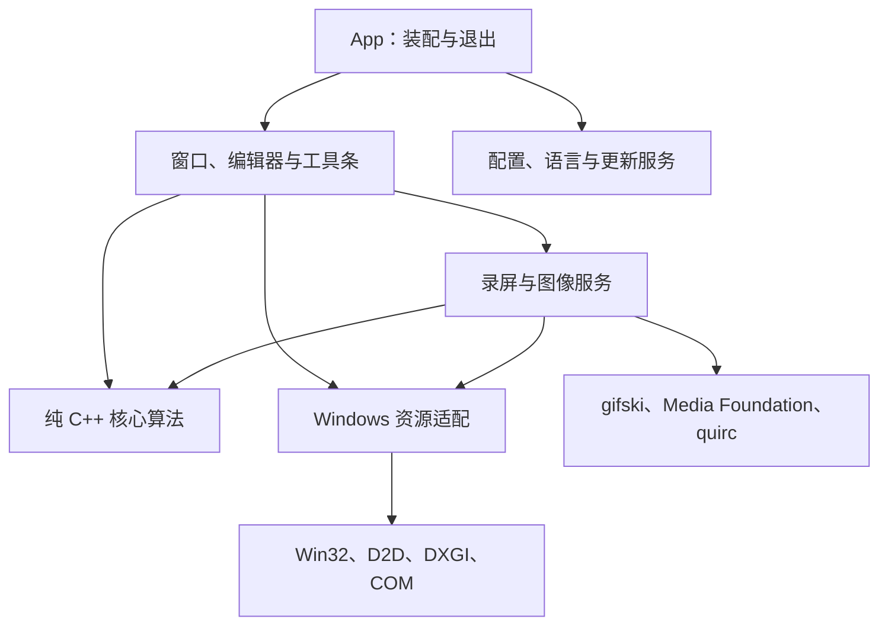

# 架构与扩展约定

## 1. 目标与边界

ScreenCapture-Plus 是基于 Ling、Win32、Direct2D/DirectWrite 和 Windows 媒体能力的原生截图工具。重构以 `5e4713e2fbe333873abff911424a212923489ccd` 为功能基线，保留原生窗口、界面布局、快捷键、配置路径、语言文件、OCR 插件约定及 GIF/MP4 编码策略。

本项目采用模块化单体。源码边界用于控制职责、所有权和编译依赖，最终仍生成一个 `ScreenCapture.exe`。没有增加常驻子进程、浏览器运行时、依赖注入容器或动态插件框架。OCR 仍是原有的可选外部 ImageReader 插件。

## 2. 目录与职责

| 目录 | 负责的事情 | 扩展入口 |
| --- | --- | --- |
| `src/app` | 应用初始化、参数分流、全局快捷键动作装配、退出顺序 | `App`、`main.cpp` |
| `src/capture` | 框选状态、选区遮罩、取色器、长截图与预览 | `WinCap`、`CutMask`、`CapLong` |
| `src/recording` | 录屏会话、GIF/MP4 编码、音视频工作线程 | `CapVideo`、`VideoGif`、`VideoMp4` |
| `src/editor` | 钉图窗口、图形工厂、历史与文本编辑生命周期 | `WinPin`、`History`、`ShapeFactory` |
| `src/editor/shapes` | 原有八种图形的绘制、命中测试及拖动 | `ShapeBase` 派生类 |
| `src/ui` | 托盘、提示、工具条、设置窗口及控件 | `toolbars`、`settings` |
| `src/services` | 配置、语言、图像导出、OCR/QR、应用更新 | `Setting`、`Lang`、`ImageExport`、`ImageRecognition`、`Update` |
| `src/platform/windows` | Win32/COM 资源所有权与屏幕采集适配 | `GdiCapture`、`ComApartment` |
| `src/core` | 无 Windows/Ling 依赖的历史、像素、滚动匹配和版本解析 | 独立 C++20 头文件 |
| `third_party` | quirc、cgif 的原有源码及依赖许可说明 | `NOTICE.md` |
| `resources` | EXE 图标、字体、内置语言资源索引、版本资源 | `Resource.rc`、`Version.h` |
| `Lang` | 原有 UTF-16 语言文件，目录和格式不变 | 按已有 key 扩展 |
| `build/windows` | 应用/Ling/Yoga 的 MSBuild 工程与公共属性 | `.vcxproj`、`.props` |
| `build/dependencies.lock.json` | 固定 Ling/gifski 提交及 Rust 工具链 | 显式依赖升级 |
| `scripts` | 本地与 CI 共用的还原、构建、验证和打包入口 | PowerShell 7 脚本 |
| `tests` | 不依赖 GUI 的回归与既有 AHK 启动快捷方式 | 每个 `.cpp` 是独立测试程序 |

窗口和工具条共同构成表现层，当前仍通过具体类型相互协作；这里没有声称已经消除所有 UI 内部双向依赖。稳定边界在于：核心算法不认识窗口；平台资源管理不认识工具条；服务不负责创建截图窗口；第三方实现不混入业务目录。

## 3. 设计选择

### 3.1 应用装配与资源生命周期

`App` 是装配入口。配置服务接收截图回调，不再直接包含 `WinCap`；全局快捷键和第二实例启动仍调用同一个截图动作。保留原有单例访问方式，使本轮改动集中在真实的耦合和生命周期风险。

退出先停止更新定时器并让后台完成回调失效，再关闭窗口/录屏会话，释放语言与配置中的 WinRT 对象，最后调用 `Ling::dispose()`。后台更新捕获独立的路径、版本、DispatcherQueue 和生命周期状态，不在工作线程中重新访问已经销毁的 UI 单例。

### 3.2 平台适配与 RAII

`GdiCapture` 独占屏幕 DC、内存 DC、选入的 DIB 与原 GDI 对象。尺寸不变时复用资源；改变尺寸时重建；析构恢复原对象并释放资源。它限定为单线程使用，返回的像素视图仅在下次捕获、重建或释放之前有效。

统一像素契约是：**BGRA、从上到下、紧密行排列、屏幕像素 alpha=255**。GIF 编码自行转换成 RGB；PNG 和剪贴板继续使用原有输出格式。GDI 完成绘制后先 `GdiFlush`，再读取像素；不把 `BI_RGB` 未定义的高字节误当成透明度。

`ComApartment` 在创建它的线程配对 COM 初始化/退出。录屏线程按 COM → Media Foundation → 编码对象的顺序创建，并按相反顺序释放。

### 3.3 图形工厂与历史模型

`ShapeFactory` 维护现有 rect、ellipse、arrow、number、line、text、mosaic、eraser 到图形类的映射。`History` 只协调历史操作、窗口刷新和借用指针；新增图形不会再扩大历史类中的分支。

`HistoryStack<T>` 用拥有对象的连续容器和有效前缀长度表达撤销状态。撤销/重做只移动游标，复杂度 O(1)。渲染、编号和悬停只读取有效前缀；新操作释放 redo 后缀；精确删除仅删除目标对象。

延迟删除文本使用“历史生命周期 + 单调条目 ID”的票据。回调执行时先解析票据，历史已关闭、元素已删除或地址被新元素复用时不执行旧删除。删除和撤销会清理窗口中的 `shapeHover` / `newShape` 借用。

### 3.4 图像输出与识别适配

原 `Util` 已分为 `ImageExport` 与 `ImageRecognition`。前者处理 PNG、DIBV5/24bpp DIB/PNG 剪贴板格式、另存为与文件剪贴板；后者处理 ImageReader 进程边界和 quirc 解码。屏幕采集由平台层统一提供。

图像输出验证尺寸乘法，24bpp DIB 行尾填充清零；quirc 对象使用带 deleter 的 `unique_ptr`。OCR 查找顺序、命令行参数、缓存文件约定及 QR 的灰度权重和文字解码回退均沿用既有协议。

### 3.5 编译依赖与第三方代码

媒体编码从大型 inline `.hpp` 拆成窄参数头和独立 `.cpp`。窗口/工具条引用会话接口时，不会重新编译整个媒体实现。MSBuild 用 `ProjectReference` 表达应用 → Ling → Yoga 依赖，公共编译/链接属性集中维护。

quirc/cgif 原源码按原字节移动到 `third_party`，没有以重构为由重写算法。Ling/gifski 从固定提交恢复到忽略的 `.deps`。本地构建与 CI 使用相同脚本，不依赖作者机器上的盘符。

## 4. 性能改动与可验证结论

| 路径 | 基线问题 | 当前实现 | 能直接确定的收益 |
| --- | --- | --- | --- |
| 截图/GIF | DDB 抓屏后 `GetDIBits` 再复制到 BGRA vector | DIBSection 直接提供可读帧 | 去掉中间 BGRA 整帧副本与相关分配；alpha 规范化仍有一次写入 |
| 长图采集 | 每次滚动重新创建 DC/bitmap | 会话内复用 `GdiCapture` | 降低资源反复创建/释放 |
| 长图拼接 | 每步分配新累计图，再复制全部旧结果 | 复用 vector 容量，写入需要更新的尾部 | 不再每步复制完整累计图，容量扩展按 vector 的摊销策略进行 |
| 滚动匹配 | 对每个候选完整扫描全部条带 | 误差已无法胜出时提前结束 | 减少无效比较；结果、阈值和 tie-breaking 保持一致 |
| 灰度转换 | 重复分配并转换旧帧和多个条带 | 两个灰度缓冲交换复用 | 旧参考灰度不重复转换，底部匹配复用同一帧灰度 |
| 长图预览 | 对不可见的超长预览也分配并重采样 | 只生成工具条上方可见尾部，受设备位图尺寸约束 | 极窄长图不会制造巨大的不可见缩略图；可见区域仍按原坐标采样 |
| MP4 裁剪 | 每帧先扩为整屏再缩为选区 | 直接按选区分配 | 省掉多余整屏零填充 |
| 音频空闲 | loopback 无数据时紧密轮询 | 无包时短暂让出 CPU | 消除该路径的纯空转 |
| 图形历史 | 查找未撤销项并逐帧跳过撤销项 | O(1) 游标与有效视图 | 历史切换不随记录总数扫描；已撤销项不参与渲染遍历 |

例如 3840×2160×4 的 BGRA 副本约为 31.6 MiB；去掉 GIF 的这一副本是内存结构上的减少。CPU 占用、实际帧率、编码耗时仍取决于硬件、驱动、内容和音源，不能把字节数推算写成已经实测的百分比加速。

录屏仍保留 16 fps GIF、30 fps MP4、既有质量参数、HEVC→H.264 回退和混音规则。停止标志使用原子变量，音频工作线程由对象持有并 join；等待音源时每 100 ms 检查停止请求，避免不可唤醒的永久等待。

## 5. 功能基线

| 行为 | 本轮约束 |
| --- | --- |
| 选区、调整、取色器、RGB/HEX/CMYK 复制 | 保留 |
| 原有八种图形、Shift 约束、修改/删除 | 保留，修复错误删除和未定义撤销状态 |
| 撤销、重做、保存、复制、双击完成 | 保留 |
| 钉图、Ctrl+滚轮缩放、原像素导出 | 保留 |
| 长截图滚动节奏、顶部/底部匹配、长度限制 | 保留；仅优化内部内存与比较 |
| GIF、MP4、扬声器与麦克风选项 | 保留 |
| OCR、QR、语言、便携配置、托盘、自动启动 | 保留；修复语言回退 |
| 所有既有 `--enter` / `--auto-quit` 参数 | 保留 |
| 自动更新时机与确认交互 | 保留；发布源改为本仓库 Release，避免分支被上游替换 |

## 6. 后续扩展

新增图形：实现 `ShapeBase` 派生类，在 `ShapeFactory` 添加一个映射，再连接已有工具条；不要把工厂逻辑放回 `History`。增加核心行为回归，涉及焦点或拖动时执行 Windows 手工验收。

新增导出格式：在图像服务边界实现格式编码，保留清晰的像素布局说明；不要让窗口自行管理 WIC 编码器或剪贴板句柄。

新增捕获后端：保持帧布局与所有权约定，先在平台层实现后端，再接入会话；已有 GDI 和 DXGI 路径承担不同场景，不能在没有多屏/HDR/权限验证时简单互换。

新增录屏编码器：由 `CapVideo` 管理会话与 UI，编码实现放独立翻译单元；明确开始、失败、停止、最终文件落盘及线程退出时序。

升级依赖：修改锁文件，检查对应许可与 API，再执行 Release/Debug 构建、核心测试、独立 EXE 启动、打包检查及 [Windows 手工验收](VALIDATION.md)。不要让 CI 构建任意漂移的上游 main。

## 7. 已知边界

现有 MP4 实现仍包含较大的 Media Foundation / WASAPI 实现单元，本轮只收窄公开依赖并修复资源/线程边界，没有改写编码算法。UI 组件仍按 Ling 的事件模型工作。截图、显卡复制、真实音频、DPI、输入法与焦点必须在 Windows 桌面上验收，纯算法测试和托盘启动检查覆盖不了这些硬件/交互场景。

相关依据：[CreateDIBSection](https://learn.microsoft.com/en-us/windows/win32/api/wingdi/nf-wingdi-createdibsection)、[GetIconInfo](https://learn.microsoft.com/en-us/windows/win32/api/winuser/nf-winuser-geticoninfo)、[DXGI ReleaseFrame](https://learn.microsoft.com/en-us/windows/win32/api/dxgi1_2/nf-dxgi1_2-idxgioutputduplication-releaseframe)、[C++/WinRT 异步与线程](https://learn.microsoft.com/en-us/windows/apps/develop/cpp-winrt/concurrency-2)。
