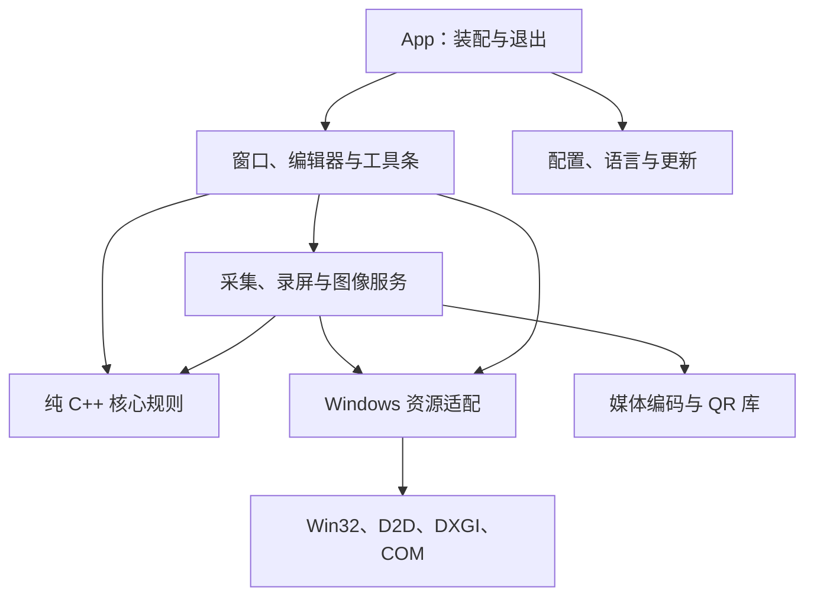

# huhucapture 架构与扩展

## 产品边界

huhucapture 是使用 C++20、Ling、Win32、Direct2D / DirectWrite 和 Windows 媒体能力的模块化单体。最终交付一个 `huhucapture.exe`，涵盖截图、钉图、绘图、矩形批注、长截图、GIF / MP4 录屏和 QR 解码。普通序号与批注分别承担独立标记和范围说明。

模块划分用于约束职责、依赖和资源所有权。窗口和工具条仍按 Ling 事件模型、通过具体类型协作；当前结构并不意味着 UI 内部所有双向依赖都已消除。扩展优先沿已有边界进行，保持启动与分发方式稳定。

## 目录地图

| 路径 | 职责 | 主要入口 |
| --- | --- | --- |
| `src/app` | 生命周期、参数分流、全局快捷键、产品标识 | `App`、`main.cpp`、`Brand.h` |
| `src/capture` | 框选、遮罩、取色、长截图与预览 | `WinCap`、`CutMask`、`CapLong` |
| `src/recording` | 录屏会话、编码和音视频线程 | `CapVideo`、`VideoGif`、`VideoMp4` |
| `src/editor` | 钉图、图形创建、活动历史、输入生命周期 | `WinPin`、`History`、`ShapeFactory` |
| `src/editor/shapes` | 图形绘制、指针状态、批注范围及文字所有权 | `ShapeBase`、`ShapeAnnotation` |
| `src/ui` | 托盘、设置、提示、工具条与批注面板 | `toolbars`、`settings`、`AnnotationPanel` |
| `src/services` | 配置、语言、图片导出、批注合成、二维码和更新 | `ImageExport`、`AnnotationRenderer`、`ImageRecognition` |
| `src/platform/windows` | Win32 / COM 资源封装、屏幕采集适配 | `GdiCapture`、`ComApartment` |
| `src/core` | 标准库算法与数据规则 | 像素、历史、批注、区域几何、滚动匹配、版本解析 |
| `resources` | 图标、字体、内置语言与 EXE 版本资源 | `Resource.rc`、`Version.h` |
| `assets/brand` | 可维护的 SVG 与派生 PNG 品牌资产 | 见 [BRAND.md](BRAND.md) |
| `Lang` | UTF-16 BOM 外部语言文件 | `Language.locale.json` |
| `build/windows` | 应用及依赖工程、公共属性、默认版本 | `huhucapture.vcxproj`、`.props` |
| `build/dependencies.lock.json` | 固定依赖提交与工具链 | 依赖恢复的输入 |
| `scripts` | 本地与 CI 共用的恢复、构建、检查、打包和发布 | PowerShell 7 入口 |
| `tests` | 纯 C++ 回归；每个顶层 `.cpp` 是独立程序 | 核心测试 |
| `tests/windows` | 实际原生渲染与独立 GUI 集成 | WARP、PNG、窗口和剪贴板 |
| `third_party` | quirc / cgif 代码、依赖来源与许可 | `NOTICE.md` |
| `releases` | 显式发布意图及版本说明 | `publish.json`、`v0.0.1.md` |

以下图示描述职责关系；具体 UI 类型之间仍有协作调用：

核心代码不认识窗口；平台资源适配不管理工具条；服务不创建截图窗口。项目内头文件以 `src` 为根，生成文件位于 `artifacts`，恢复的依赖位于 `.deps`，生产依赖通过 MSBuild 项目引用表达。

## 生命周期与所有权

### 应用和线程

`App` 装配截图动作、参数入口、快捷键和服务。配置服务通过回调请求截图，快捷键与第二实例启动复用同一个动作。UI 对象、配置和语言中的 WinRT 对象由 UI 线程访问。

退出先停止更新定时器、使后台回调失效，再关闭窗口与录屏会话，释放语言/配置中的 WinRT 对象，最后释放 Ling。后台更新持有独立路径、版本、DispatcherQueue 和生命周期状态，不能在工作线程中重新访问已销毁的 UI 单例。

工作线程由会话或编码对象拥有。停止信号发出后 join，再释放线程可访问的缓冲、COM 对象和系统句柄。`ComApartment` 在所属线程配对初始化和退出；媒体会话按依赖顺序创建、按逆序释放。

### 采集与像素

`GdiCapture` 用 RAII 拥有屏幕 DC、内存 DC、DIB 和旧选入对象。同尺寸捕获复用资源，尺寸变化时重建，析构时恢复旧对象并释放拥有的句柄。对象只供单线程使用；借用像素在下次捕获、重建或销毁前有效。

屏幕帧契约是 **从上到下、紧密排列的 BGRA，屏幕 alpha 为 255**。读取前先完成 GDI 绘制并 `GdiFlush`，不将 `BI_RGB` 未定义的高字节解释为透明度。服务边界检查宽高、stride、乘法溢出和缓冲长度。GIF 在编码边界转换 RGB；其他原始图像仍可具有需要保留的 alpha。

## 编辑模型

### 图形创建与历史

`ShapeFactory` 显式映射 rect、ellipse、arrow、number、annotation、line、text、mosaic、eraser。新增图形实现 `ShapeBase` 并登记映射，工具条只发送选择意图。

`HistoryStack<T>` 用拥有对象的连续容器和活动前缀表达历史。撤销 / 重做移动游标，核心游标操作为 O(1)；窗口重绘、命中和列表同步的成本另计。只遍历活动前缀，新操作释放 redo 后缀，精确删除移除目标对象。

延迟文本删除采用历史生命周期与单调条目 ID 的票据，回调执行时重新解析。历史已关闭、目标已删除或地址被复用时，旧票据不再生效。删除与撤销同时清理窗口借用的悬停 / 新建指针。`ShapeText` 的编辑器限定在图像视口内，批注的共享输入框由右侧面板管理。

### 批注的数据边界

`ShapeAnnotation` 拥有矩形、稳定 ID 和完整文字，徽章位置由矩形左上角派生。窗口级 `AnnotationSequence` 只增加，不因删除、撤销、取消新建或清除 redo 分支回收编号。颜色由 ID 计算；普通序号仍使用独立逻辑。

`core/AnnotationRegion.h` 负责归一化、有效性、移动、调整和命中等纯规则。边框向内绘制，与小编号同色；区域内部可继续绘制。几何限于原图，移动保留尺寸，最小范围约束与预览缩放正确换算。

`AnnotationPanel` 在同一个窗口内绘制可滚动列表，缓存文字布局，并使用一个共享 `TextBox` 编辑选中项。列表是活动历史的快照，shape 始终拥有完整文字。文字原位写回，目前不为每个字符建立图形历史或独立文本撤销栈。

`WinPin` 协调工具、视图、命中、列表和焦点。新框完成后进入文字输入；移动/调整既有范围不抢输入焦点。失捕获或失焦会清理未完成新框，已有范围停在最后有效位置。面板导致的视图适配应延迟到当前拖动结束，避免坐标跳变。被动工具条布局使用 `SWP_NOACTIVATE`；鼠标离开哨兵先过滤再进入拖动逻辑。

## 服务与输出

### 图片、剪贴板和二维码

`ImageExport` 处理 PNG、另存为和剪贴板，提供 DIBV5、24bpp DIB 与 PNG 格式。它验证尺寸乘法并清零 24bpp 行尾填充，调用方使用实际返回宽高读取合图像素。

`ImageRecognition` 负责 quirc 解码和负载文字转换。quirc 对象使用带 deleter 的 `unique_ptr`；灰度权重、镜像重试及 UTF-8 / Shift-JIS 回退规则保持一致。OCR 及外部识别插件不属于当前应用路径。

### 批注合图

导出先收集活动批注并按 ID 排序，再由 `AnnotationRenderer::makePlan()` 用 DirectWrite 完整测量文本，交给核心布局计算字号、行和列。随后在原始图像尺寸绘制底图和全部活动图形，`render()` 依据同一份计划生成右侧说明区，并用 `CopyFromBitmap` 将原图像素及 alpha 复制到输出左上角。

核心布局不知道字体系统，renderer 不依赖 App、Ling、PCH 或全局设置。`Plan` 可以复用，避免测量规则和实际绘制脱节；面板摘要布局与完整导出分别处理。失败不能替换已有的有效计划或结果。

布局先收紧字号、徽章和间距，再增加画布高度或右侧列。原图不缩小，完整备注不截断，单条备注保持在一个行框。没有活动批注时维持原尺寸。设备边长和 BGRA 像素预算无法满足时返回失败，窗口保留编辑状态。参数与交互见 [ANNOTATIONS.md](ANNOTATIONS.md)。

### 身份、配置和更新

`src/app/Brand.h` 集中运行时产品名、仓库和更新地址，C++ 命名空间为 `HuhuCapture`；版本由 `build/windows/Version.props` 提供。项目、EXE、配置目录与资产统一使用 `huhucapture`，资源与品牌说明保持一致。

配置默认位于 `%appdata%\huhucapture`，EXE 同目录已有 `config.json` 时采用便携配置。外部 `Lang` 目录是 EXE 旁优先、AppData 回退，二者不合并。改名不自动搬迁其他目录的配置。

更新器从 `NAMEWTA/huhucapture` 的 latest 稳定 Release 读取版本，并在同一份响应中选择固定的 `huhucapture.exe` 资产，下载后核对文件版本。后台检查遵循常驻、空闲和每日频率；安装前请求确认。缺资产、非法版本、预发布或网络失败不改变现有安装。

## 性能约束

性能工作以明确减少分配、复制、等待或无效遍历为依据，实际耗时与资源峰值另行测量。

| 路径 | 当前策略 | 仍需关注 |
| --- | --- | --- |
| 截图 / GIF 输入 | DIBSection 提供可读缓冲，同尺寸复用 DC / bitmap | alpha 规范化与编码转换仍需处理像素 |
| 长图拼接 | 复用容量，只写需要更新的尾部 | 扩容仍会分配，最终长图受尺寸与内存限制 |
| 滚动匹配 | 无法胜出的候选提前退出，灰度缓冲交换复用 | 匹配阈值、结果和相同误差时的选择不能悄然改变 |
| 长图预览 | 只生成可见尾部并受设备位图限制 | 源坐标与可见采样必须一致 |
| MP4 选区 | 按输出选区尺寸分配中间缓冲 | 编码器、驱动与音源仍影响实际速度 |
| 空闲音频 | 无数据时让出 CPU，可响应停止 | 停止信号、线程 join 与最终文件落盘顺序 |
| 图形历史 | O(1) 游标，渲染仅访问活动前缀 | 列表同步与窗口刷新仍可能为 O(N) |
| 批注输入 | 一个共享编辑器，缓存列表文字布局 | 大量条目的测量、同步与完整导出仍有成本 |

当前录屏策略保留 GIF 16 fps、MP4 30 fps、既有质量设置、HEVC → H.264 回退与混音规则。这些属于产品行为，不能作为内部优化随意调整。代码上消除一份整帧副本可以据像素数估算节省的缓冲容量，但不能直接换算成经过实测的帧率或 CPU 百分比。

## 扩展方式

| 新需求 | 放置位置与约束 |
| --- | --- |
| 新图形 | `ShapeBase` 派生类 + `ShapeFactory` 映射 + 现有工具条；核心规则可独立测试 |
| 批注交互或排版 | 纯规则在 `core`，完整 DWrite 度量及 D2D 合成在 renderer；保留稳定 ID、文字所有权与原图像素 |
| 导出格式 | 扩展图像服务，明确像素格式；不让窗口自行管理编码器和剪贴板句柄 |
| 捕获后端 | 平台层实现同样的帧与所有权契约，再接入会话；验证多屏、HDR、权限和失败恢复 |
| 录屏编码器 | 独立实现单元，由 `CapVideo` 管理会话；明确开始、失败、停止、落盘和退出 |
| 依赖升级 | 更新锁文件与许可，执行 Release / Debug、核心、原生、启动、打包与相关桌面验证 |
| 品牌或版本 | 统一入口、资源和发布元数据一起更新，不在代码中散落仓库 / 产品字面量 |

## 验证边界

较大的 Media Foundation / WASAPI 实现单元仍承担 MP4 编码；Ling UI 仍使用现有事件模型。核心测试、WARP 字体和 PNG 测试、独立 GUI 消息测试分别验证不同层次，不能代替真实输入、IME、混合 DPI、显卡复制或音频硬件验收。

具体自动化证据与手工矩阵见 [VALIDATION.md](VALIDATION.md)。构建依赖、静态 CRT、发布资产与版本一致性见 [BUILDING.md](BUILDING.md)。这些文档中的结构约束以当前源码为准，测试结论以对应提交的实际运行结果为准。
