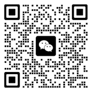

[简体中文](../README.md) | [English](ReadMe.en-US.md) | Русский | [Bahasa Indonesia](ReadMe.id-ID.md)


# ScreenCapture-Plus

**ScreenCapture-Plus v0.0.1** — развиваемая ветка [xland/ScreenCapture](https://github.com/xland/ScreenCapture), нативного приложения Windows для снимков экрана. Доступны рисование, длинные снимки, запись GIF / MP4, распознавание QR-кодов и нумерованные примечания, которые сохраняются вместе с изображением.

## Панели инструментов и примечания

- Кнопки на панелях снимка, рисования, записи, длинного снимка и стиля имеют область нажатия **44 × 44 логических пикселя** и значки **24 логических пикселя**. Размер учитывает DPI; на узком экране кнопки переносятся на следующую строку без уменьшения области нажатия.
- Существующий инструмент **Номер** остаётся доступен. Рядом добавлен инструмент **Примечание** со значком пронумерованного облачка.
- Номер и цвет назначаются автоматически. Перемещение, отмена и повтор сохраняют номер, цвет и текст примечания; удаление другой записи не меняет нумерацию оставшихся.
- При сохранении или копировании снимок, метки и пояснения справа объединяются в одно изображение. Текст переносится, размер шрифта подстраивается под доступное место; при необходимости увеличивается высота изображения или добавляются колонки справа.
- Масштаб предпросмотра не снижает разрешение исходного снимка при экспорте. Если полный результат превышает ограничения ресурсов, приложение сообщает об ошибке и сохраняет текущие правки.

### Добавление примечания

1. Выделите область и откройте редактор кнопкой рисования / закрепления. Если удерживать `Ctrl` при выделении, редактор откроется сразу.
2. Выберите **Примечание** рядом с инструментом **Номер**.
3. Нажмите на изображение, чтобы поставить метку, затем введите текст справа. Поддерживаются несколько строк.
4. Выберите метку или запись в списке для редактирования; перетащите метку, чтобы изменить её положение.
5. Нажмите кнопку сохранения или копирования на панели. `Ctrl+S` сохраняет и во время ввода примечания. В текстовом поле `Ctrl+C` копирует текст; для копирования целого изображения сначала нажмите `Esc`.

Список примечаний прокручивается. Скрытие панели не удаляет записи и не исключает их из экспорта. Подробности — в [руководстве по примечаниям](ANNOTATIONS.md).

## Другие возможности

- Обычные и длинные снимки, запись GIF / MP4; для MP4 доступны системный звук и микрофон.
- Распознавание QR-кодов и копирование результата.
- Пипетка: `Ctrl+R` — RGB, `Ctrl+H` — HEX, `Ctrl+K` — CMYK.
- Прямоугольники, эллипсы, стрелки, номера, линии, текст, мозаика и ластик; `Shift` ограничивает форму или направление линии.
- Изменение и удаление элементов при наведении; `Ctrl+Z` — отмена, `Ctrl+Y` — повтор.
- `Ctrl+S` — сохранение, `Ctrl+C` или двойной щелчок — копирование. Во время ввода клавиши обрабатывает текстовое поле.
- `Ctrl` + колесо мыши меняет масштаб предпросмотра; доступны трей, однократный запуск и несколько языков.
- Один `ScreenCapture.exe`, без установки. Зависимости приложения связаны статически; отдельная установка среды Visual C++ не требуется.

## Загрузка и требования

[Скачать v0.0.1](https://github.com/NAMEWTA/ScreenCapture-Plus/releases/tag/v0.0.1) · [Все выпуски](https://github.com/NAMEWTA/ScreenCapture-Plus/releases)

Выпуск включает EXE, переносимый ZIP для Windows x64, ZIP с отладочными символами, `build-info.json` и `SHA256SUMS.txt`. В переносимом архиве есть языковые файлы и лицензии зависимостей. Размеры указаны у файлов выпуска.

Требуется **Windows 10 1803 или новее, x64**. Перед ручным обновлением завершите предыдущий процесс.

## Сборка и проверка

Нужны Windows x64, Visual Studio 2026 с Desktop development with C++ и ATL, PowerShell 7, Git и Rustup. Скрипты получают закреплённые версии Ling / Yoga / gifski.

```powershell
pwsh ./scripts/build.ps1 -Configuration Release
pwsh ./scripts/test.ps1
pwsh ./scripts/test-windows.ps1
pwsh ./scripts/smoke.ps1
pwsh ./scripts/test-windows.ps1 -Gui
pwsh ./scripts/package.ps1
```

EXE создаётся в `artifacts/bin/x64/Release/ScreenCapture.exe`; после первой сборки можно открыть `ScreenCapture.slnx`. Тесты алгоритмов, нативного рендеринга / PNG и запуска не заменяют проверку взаимодействия, DPI, ввода текста и аудио/видео по [списку проверок Windows](VALIDATION.md).

Документация: [сборка и выпуски](BUILDING.md), [архитектура](ARCHITECTURE.md), [разработка](../CONTRIBUTING.md), [лицензии зависимостей](../third_party/NOTICE.md).

## Командная строка

```powershell
# Завершить процесс после задачи
ScreenCapture.exe --auto-quit=true
# Редактор после выделения области
ScreenCapture.exe --enter=pin
# Длинный снимок
ScreenCapture.exe --enter=long
# Запись экрана
ScreenCapture.exe --enter=video
# QR-код; также принимается --enter=qrcode
ScreenCapture.exe --enter=qr
# Только значок в трее
ScreenCapture.exe --enter=tray
# Совместное использование параметров
ScreenCapture.exe --enter=long --auto-quit=true
```

## Переносимые настройки и языки

По умолчанию настройки находятся в `%appdata%\ScreenCapture\config.json`. Существующий `config.json` рядом с EXE имеет приоритет. Дополнительные языки загружаются из папки `Lang` рядом с EXE, если она существует; иначе — из `%appdata%\ScreenCapture\Lang`. Упрощённый китайский и английский встроены в EXE. См. [настройку языков](../Lang/ReadMe.md).

## Автор исходного проекта и поддержка

Сохранены имя автора исходного проекта, [лицензия MIT](../LICENSE) и информация о поддержке. Контакты и QR-коды ниже принадлежат автору исходного проекта.

<table>
  <tr>
    <td align="center">
      
      <p>Alipay</p>
    </td>
    <td align="center">
      
      <p>WeChat</p>
    </td>
    <td align="center">
      
      <p>WeChat автора</p>
    </td>
    <td align="center">
      
      <p>Блог WeChat: Desktop Software</p>
    </td>
  </tr>
</table>
