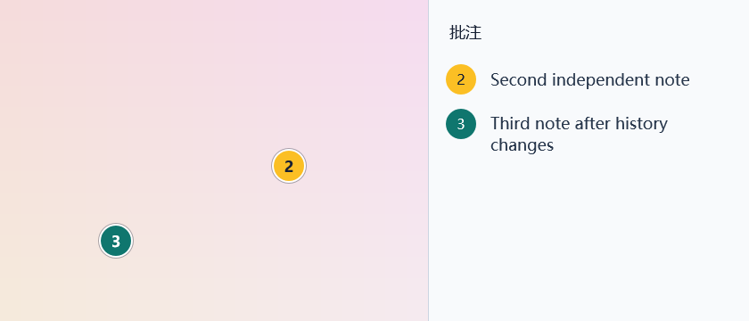

# huhucapture 批注使用与设计

批注把截图中的一块范围与文字说明绑定起来：矩形边框、左上角小编号和右侧对应条目共用自动主题色。保存或复制时，原图、活动图形与完整说明组成一张图片。

示例展示编辑器实际复制出的 PNG。编号允许不连续：删除某项不会改变其他项的编号或颜色。

## 使用流程

1. 截图框选完成后进入图像标记 / 钉图窗口，也可按住 `Ctrl` 完成框选直接进入。
2. 点击普通 **序号** 旁的 **批注** 按钮，在图片上按住左键拖出矩形。
3. 松开有效范围后，右侧共享输入框自动获得焦点，可直接输入多行说明。
4. 点击图中编号、边框或右侧条目继续编辑。拖动编号 / 边框移动整块范围，八个边角控制点调整大小。
5. 保存或复制整图。输入时 `Ctrl+S` 仍保存整图，`Ctrl+C` 复制选中文字；按 `Esc` 结束输入后再复制图片。

右侧列表可滚动，长说明以摘要展示，完整文字在共享输入框中编辑。收起说明栏只改变界面，不删除数据或排除导出。面板、输入区和短截图下方的留白不作为图片命中区域。

## 范围、编号与输入

### 普通序号和批注

| 项目 | 普通序号 | 范围批注 |
| --- | --- | --- |
| 数据 | 独立序号图形 | 矩形范围、编号、完整说明 |
| 配色 | 当前工具条颜色 | 稳定 ID 对应的自动颜色 |
| 编号大小 | 原有半径滑块、拖动和滚轮行为 | 默认直径 24、字号 13 逻辑像素，随编号文字适配 |
| 编辑 | 在图片内操作图形 | 图中范围与同窗口右侧说明联动 |
| 导出 | 绘入图片 | 绘入范围 / 编号，并在右侧排版完整说明 |

两者互相独立，普通矩形也保留原有行为。范围批注无需手动选色，编号始终是图和文字的主要对应依据。

### 几何规则

矩形可以向任意方向拖出，之后归一化为有效边界。新建时，宽和高各至少 3 逻辑像素；转换到原图后使用 `ceil(3 * dpi / creationScale)`，至少 1 个原图像素。单击、零宽 / 零高和过小误拖不留下对象。

区域限制在原图 `[0, width] × [0, height]` 内。移动以整体平移处理，越界时保留原有宽高；调整大小保持对侧位置和最小有效尺寸。边框向内绘制，默认宽 2 逻辑像素。徽章锚在左上角内侧，尺寸按数字真实度量扩展，并限制在整张图片边界内。很小的区域可以小于徽章，不通过放大矩形伪造选区。

边框、编号与控制点参与命中，透明内部不拦截新标记或嵌套范围。首次展开面板可能缩小图片预览，但不会改变原始图像。新建徽章、文字与边框按创建时的 `dpi / scale` 转为源图坐标；后续视图缩放只影响显示，导出仍使用同一对象的原图尺寸。

### 焦点与中断

新范围完成后再聚焦输入框，避免文字输入与鼠标捕获互相打断。点击已有范围可编辑说明，移动或调整已有范围不自动切入输入状态。拖动时展开隐藏面板所需的窗口 / 视图适配延迟到手势结束，避免坐标跳变。

失去焦点或鼠标捕获时，未完成的新框丢弃；已有范围保留最后有效几何并停止跟随鼠标。被动工具条布局使用 `SWP_NOACTIVATE`，鼠标离开哨兵在命中或拖动计算前过滤。

输入框获得焦点后，字符、换行、选择、删除和文字复制由输入控件处理。当前共享输入框没有独立文本撤销栈；输入时 `Ctrl+Z` / `Ctrl+Y` 不会误操作整条批注，结束输入后恢复为图形历史操作。

## 身份、数据与历史

`ShapeAnnotation` 拥有 `number`、完整 `note` 和矩形。编号位置从矩形派生，不维护另一套容易失步的坐标。窗口从活动历史收集批注，按编号排序，交给面板和导出服务；面板行是显示快照，不拥有原始说明。

窗口持有一个 `Core::AnnotationSequence`，从 1 开始单调分配 ID。删除、撤销、取消新框及清除 redo 分支都不降低高水位，已分配的 ID 不再复用。撤销 / 重做图形创建时恢复原对象及其文字、范围和颜色。取消的新框也可能留下编号间隔，这是稳定身份的结果。

删除沿用直接移除对象的历史语义，文字与既有几何原位编辑，不为每次按键或移动新增一个图形历史项。若后续需要文本或几何编辑的独立撤销，应明确设计命令、合并策略和历史边界。

`annotationColor(number)` 先使用十种主题色，再以确定性的黄金角色相及饱和度 / 亮度变化扩展，颜色不依赖列表位置。核心测试检查前 256 个 ID 的 RGB 唯一性及数字前景至少 4.5:1 的对比度；这不意味着任意数量的颜色都能被人眼轻易区分。

## 合并导出

导出由同一份真实文字度量计划驱动：

1. `WinPin` 收集全部活动批注；`AnnotationRenderer::makePlan()` 为完整文字和编号创建 DirectWrite 布局。
2. `Core::layoutAnnotations()` 根据测量结果、图片尺寸和资源限制选择字号、行高、列数与输出尺寸。
3. 编辑器按原图像素尺寸绘制底图与全部活动图形，并完成该次离屏绘制。
4. `AnnotationRenderer::render()` 创建计划尺寸的 96-DPI BGRA 位图，绘制说明区，再用 `CopyFromBitmap` 把原图逐像素复制到左上角。
5. 调用方按结果实际宽高读取像素，交给 `ImageExport` 保存 PNG 或写入剪贴板。

原图不缩放、不重新采样，合成时保留源 alpha。高度增加时，原图下方为白色留白。没有活动批注时不生成说明区，输出维持原尺寸。

空备注使用调用方提供的本地化占位文字。中文、显式换行和无空格长 URL 都参与完整 DirectWrite 测量，关闭 trimming 并留出 glyph overhang，不能只测列表摘要。

### 布局和资源预算

| 参数 | 默认策略 |
| --- | --- |
| 每列说明宽度 | 360 个输出像素 |
| 正文字号 | 从 18px 逐步缩小，最低 12px |
| 编号字号 | 从 16px 同步适配，最低 12px |
| 编号徽章 | 按文字实际尺寸测量，直径至少 24px |
| 行间距 | 从 16px 收紧，最低 8px |
| 短图画布 | 尽量至少 240px 高，预算紧张时可压缩无必要留白 |
| 单个位图像素预算 | 默认 256 MiB 的 BGRA，不代表整个进程的峰值内存 |
| 最大边长 | 由调用方传入实际 D2D `GetMaximumBitmapSize()` |

字号变化时重新计算徽章、间距和可用文字宽度，再测量完整正文。先使用紧凑布局；仍放不下时增加画布高度，再在设备与预算内分到右侧新列。每条说明完整放在一个行框，不拆成没有编号的跨列碎片。

没有任意条目数上限。单条说明过长、总画布超出设备边长 / 像素预算或资源创建失败时，整个导出返回失败，并保留编辑会话。`makePlan()` / `render()` 失败不能覆盖调用方已有的有效输出。不能以省略号、删除尾部条目或只保存原图来冒充成功。

## 扩展约束

几何与编号规则保持标准库边界，真实字体度量与图像合成属于渲染服务，窗口只协调输入和结果。renderer 不依赖 Ling、App、设置单例或应用 PCH，确保它能够由独立 Windows 测试直接验证。

修改布局应同时解释“完整文字如何保留”和“原图像素如何保留”。增加编辑方式应明确焦点、鼠标捕获和历史的边界；不把逐字符修改悄然变成整条图形的撤销语义。新增面板显示方式不能改变稳定编号或导出内容。

保存或完成复制的最终合图通过统一媒体服务进入 [本地历史](media-history.md)，历史预览和再次复制应对应这一份已经生成的结果。不得为了补历史记录而再次抓屏、重排文字或丢失原批注。

## 验证

纯核心测试覆盖 ID / 配色、预算、紧凑布局、完整行、区域四向创建、边界移动 / 调整和非整数缩放。Windows WARP 测试直接编译正式 renderer，验证真实字体、换行、颜色、PNG 回读、源像素 / alpha 与渲染状态恢复。

独立 GUI 测试链接正式 Release 对象，通过实际窗口消息驱动工具条、范围、共享输入框、列表和复制命令，检查合图 PNG。它保留硬超时和明确的环境失败结果，正式 EXE 不增加测试入口。

脚本输入不等于真实 IME 组合或所有物理鼠标交互。高 DPI、多屏、输入焦点和设备相关场景仍按 [验证指南](validation.md) 分别记录；文档中的目标检查不代表某次构建已经通过。
