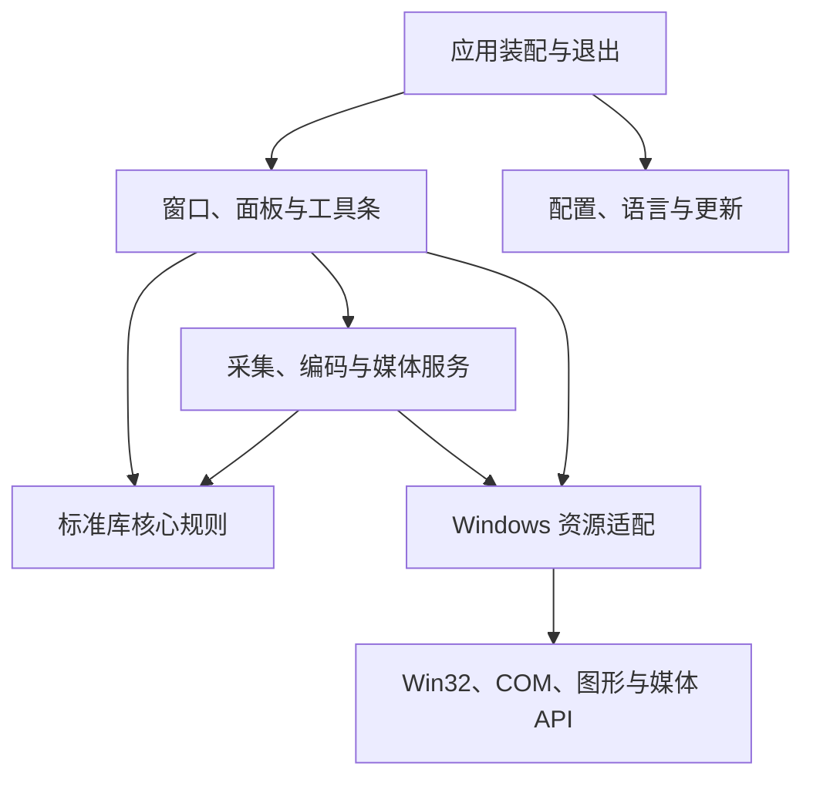

# 架构与扩展

## 为什么保持原生模块化单体

huhucapture 是 C++20、Ling、Win32、Direct2D / DirectWrite 与 Windows 媒体能力组成的单 EXE 桌面工具。截图、批注、长截图、GIF / MP4、QR 和媒体历史共享生命周期与渲染环境。模块边界用于控制职责、依赖与资源所有权，避免为一个桌面操作引入进程通信和额外运行时。

新增能力先复用现有代码和平台组件。核心规则保持可独立验证；界面使用已有的事件模型协作。这不是要求所有类型都通过抽象接口通信，而是要求平台资源、业务规则和窗口交互各有明确所有者。

## 目录地图

| 路径 | 职责与扩展边界 |
| --- | --- |
| `src/app` | 装配、参数分流、全局快捷键、应用退出与统一产品身份 |
| `src/capture` | 区域框选、遮罩、取色、长截图与预览；不负责历史文件管理 |
| `src/recording` | 录制会话、帧与音频采集、编码和线程停止；完成编码后才交出可用文件 |
| `src/editor`、`src/editor/shapes` | 图形与备注的拥有关系、活动历史、焦点和编辑协作 |
| `src/ui` | 托盘、设置、历史窗口、面板和工具条；发出操作意图，展示真实结果 |
| `src/services` | 配置、语言、图像合成与导出、媒体归档、识别和更新；集中保存/复制契约 |
| `src/platform/windows` | Win32 / COM 资源封装与捕获适配；不管理具体窗口业务 |
| `src/core` | 仅标准库的像素、几何、编号、历史、命名与版本规则；不依赖 Windows 或全局设置 |
| `resources`、`Lang` | 编译进 EXE 的资源和外部 UTF-16 语言数据；运行时目录名属于既有契约 |
| `assets/brand` | 手工 SVG 源与派生品牌资源；维护规则只写在 `docs/brand.md` |
| `build`、`scripts` | 固定依赖、Windows 工程和本地/CI 共用入口；生成物放入 `artifacts` |
| `tests`、`tests/windows` | 纯规则与真实 Windows 能力分层验证，测试入口不进入产品 EXE |
| `docs` | 设计理由、工程约束、失败语义和验收边界；Markdown 文件名全小写 |
| `releases` | 桥接意图 `bridge-publish.json` 与各版本说明；当前发布只接受通过验证的同一提交 |
| `third_party` | 被分发的依赖源码、许可和来源；恢复的依赖使用 `.deps` |

核心代码不认识窗口，服务不创建截图窗口，平台封装不决定工具条布局。具体 UI 类型可以直接协作，但不应因此把编码、持久化或纯规则重新塞回点击处理函数。

## 生命周期与线程

UI、语言和配置 WinRT 对象属于 UI 线程。后台任务携带独立数据与生命周期标记；回调抵达时重新确认目标仍存在。关闭窗口不等于所有排队回调都已消失，切换设置页面也会使其旧节点失效。

会话拥有工作线程，停止时先发信号并 join，再释放缓冲、COM 对象或句柄。应用退出先停止更新与后台回调，再关闭窗口和录制会话，最后释放语言/配置及 Ling。COM 的初始化与清理由同一线程配对。

媒体历史中的缩略图可重建，原始截图和录屏不可当成缓存。后台缩略图结果不能延长已关闭窗口的寿命；历史的分页和有界处理用于控制打开大量视频时的工作量。

## 像素与导出

屏幕采集提供紧密排列、从上到下的 BGRA，屏幕 alpha 为不透明；其他导入/合成图像的 alpha 仍需保留。借用缓冲在下一次捕获、重建或销毁前有效。宽高、stride 和乘法在分配前校验，不依赖调用者一定传入正常尺寸。

批注导出以原图坐标完成，测量完整文字后决定扩高或分列，再按实际输出尺寸读取像素。原图保留在左上角且不缩小。预算或设备边长不允许完整结果时，保留编辑状态并报告失败；不能截断备注、丢弃条目或静默只导出底图。设计理由与输入契约见 [批注设计](annotations.md)。

图像剪贴板保留 PNG / DIB 等兼容格式，录屏使用已经归档的稳定文件路径。归档成功、另存为成功和剪贴板写入成功是不同结果，失败信息必须对应实际操作。长期存储、命名、防覆盖和清理范围集中在 [媒体历史](media-history.md)。

## 三种历史的边界

| 历史 | 拥有的内容 | 生命周期 |
| --- | --- | --- |
| 编辑器撤销历史 | 当前窗口中的图形、范围、稳定编号与完整备注 | 编辑会话内 |
| 媒体剪切复制板 | 已经完成导出的 PNG / GIF / MP4 | 文件存在期间，跨应用重启 |
| Windows 剪贴板 | 当前向其他应用提供的图像或文件引用 | 由系统与后续复制操作决定 |

不能用编辑器对象保存媒体历史，也不能把系统剪贴板当成历史索引。复制后仍能找回原件依赖本地归档；撤销一次图形操作不应删除已经导出的媒体文件。

## 性能与功能契约

同尺寸采集复用 DC、bitmap 和缓冲；帧循环不反复复制整张累计长图。预览只生成需要显示的部分，缩略图按需加载。结构上减少的分配可以从代码确认，端到端耗时、峰值内存与 CPU 改善必须通过同场景测量。

录屏帧率、编码回退、音源混合、滚动匹配阈值、快捷键和文件命名会改变用户观察到的结果。内部优化不能悄然改变这些契约。涉及改动时同步解释行为与验收方式。

## 扩展应该放在哪里

| 新需求 | 决策与必须保留的契约 |
| --- | --- |
| 新图形 | 复用图形工厂与历史；明确拥有关系、命中、删除、撤销和导出 |
| 新导出格式 | 放入媒体服务；定义像素/文件契约、失败状态、剪贴板和历史展示 |
| 新捕获后端 | 平台层提供相同的帧与借用寿命，分别验收多屏、HDR、权限与失败恢复 |
| 新录屏编码器 | 独立实现单元，由会话管理启动、停止、落盘和线程回收 |
| 新历史操作 | 通过归档服务执行；维持严格目录范围和可恢复清理，窗口不自行递归操作文件 |
| 新设置 | 复用配置服务与 [界面规范](design.md)，定义默认值、保存时机和语言回退 |
| 依赖升级 | 修改锁文件、核对许可与 API，执行 Release / Debug 及受影响的原生验证 |
| 新目录或公共规则 | 先说明现有边界为何不适用；同步 [工程约定](conventions.md)，避免重复能力 |

[构建与发布](building.md) 定义版本与交付边界，[验证指南](validation.md) 区分纯规则、真实渲染、窗口消息和物理设备验收。结构约束和测试结论分别记录，不能用架构描述替代实际通过证据。
