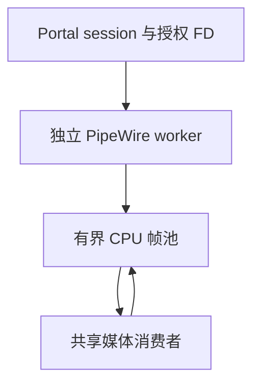

# Linux PipeWire 帧接入

这是 Issue #5 的 P00/P05/P09 前置实现：消费真实 ScreenCast 授权 FD，把已验证的 CPU 视频帧交给共享媒体合同。它与 [Portal 控制面](linux-portal.md) 分开管理线程和资源，不代表完整录屏应用、音频混合、GPU 快路径或发行验收已经完成。

## 所有权和线程边界

[PipeWireCapture](../src/platform/linux/pipewire/PipeWireCapture.h) 只在调用方拥有的 worker 上运行。它直接使用固定 PipeWire 客户端的 context、stream、SPA 格式协商和事件循环，不重写 native protocol，不引入 GStreamer，也不调用外部录屏命令。worker 不持有 QWidget、QImage 或 GLib context。Portal 授权、parent 与 session 仍由 QApplication 线程上的控制器管理。



调用方把 `takePipeWireFd()` 返回值放入 Linux `UniqueFd`，连同同一授权结果的目标交给 worker。函数在成功、连接前取消、参数错误及连接失败时都消费这个 FD；不能重复关闭已经转移的整数。ScreenCast v6 有 `pipewire-serial` 时按 `PW_KEY_TARGET_OBJECT` 连接；旧接口使用该授权 remote 内的 node ID。不会重新打开全局 PipeWire daemon，也不会根据旧 node ID 自动寻找另一个源。64 位 serial 在探针 JSON 中写成十进制字符串，避免浮点数精度丢失。

Portal 会话必须活到 worker 返回。正常停止先请求 worker 的 stop token，等待数据面终态和编码收尾，再关闭 Portal session。停止事件通过 PipeWire 自己的 event source 唤醒独立 loop；`stop_callback` 在销毁 loop 前等待正在执行的唤醒回调结束。worker 从不等待 GUI 处理消息，因此异步结果投递不形成 GUI/worker 相互等待。应用服务仍须以异步状态编排整个停止流程，不能在界面按钮中同步等待录制完成。

每个取出的 `pw_buffer` 都由局部归还对象持有：空帧、损坏帧、内存格式不支持、消费者异常和正常帧均在同一 worker 上归还。只有按行复制到帧池后的 `FrameLease` 可以离开该回调。消费者收到 lease 前，原生 buffer 已经排回 PipeWire；格式变更和 `remove_buffer` 不会撤销消费者持有的像素。停止后先移除监听，再销毁 stream、core、事件源、context 和 loop。只保留首个失败的类别、原生错误码和消息；取消不会覆盖已经发生的错误。

## 共用帧合同与预算

[MediaFrame](../src/core/MediaFrame.h) 只依赖标准 C++20 和项目既有 `PixelBuffer`、`MediaClock` 规则。它不要求媒体帧转成 QImage。共享合同可描述 BGRA8、RGBA8、NV12 和 I420 的 CPU 布局；本批 PipeWire 接入只协商前两者及等价的无 alpha RGBx/BGRx 输入。

每个 plane 分别记录 allocation 内的 offset、有效字节区间、首行偏移、有符号 stride、行有效宽度和行数。所有加法、乘法、行间距离和 plane 重叠均在发布前检查；奇数宽高的色度 plane 向上取整。行访问保留负 stride 的逻辑方向，不把底部行指针当作整段分配的起始地址。编辑器的单 plane BGRA 约束不会扩散到所有媒体格式。

生产者独占 `WritableFrame`；发布后只交付不可复制、可移动的只读 lease。消费者可以跨线程释放，释放只操作共享存储和原子 slot 状态，不调用已销毁的 FramePool 或系统 API。改变格式会产生新代次，仍在使用的旧代次像素继续有效，并占用同一个预算；不能为新格式覆盖旧 lease。

预算明确指**帧池像素分配字节**，不包含分配器、对象描述、PipeWire 原生映射及编码器自身的额外内存。每个格式代次预分配固定 slot 数，逐帧不扩容；旧代次只要仍有一个 lease，就保留该代次完整分配并计费。默认数据面采用 4 个 slot、128 MiB 像素预算和 16384 的单边上限，调用方可以提供更严格或经测量的预算。满池时明确累计丢帧数并立即归还原生 buffer；格式变化无法容纳旧 lease 与新池时返回 Budget 错误。不能把该策略称为零丢帧或完整多屏热插拔验收。

时间信息分别记录 PipeWire 原始纳秒 PTS、源时钟域、服务分配的时钟实例、序列号及本机 steady 接收时间。未提供 PTS 时保持空值，不用到达时间冒充源 PTS；源 PTS 也不会直接当作本机 steady epoch。首个格式帧、上游 DISCONT 和倒退 PTS 都标记不连续。音画校时、重采样和长时漂移补偿属于共享录制服务，当前数据面没有自行发明这套策略。

色彩的 primaries/transfer/matrix/range、有效 crop 与旋转/反射元数据随帧保留。Portal 的逻辑 size/position 不参与像素 stride 计算；实际宽高只能来自 PipeWire 协商。格式通知发生在该代次首帧前，消费者可以明确拒绝不能处理的新格式，不能继续套用旧的编码尺寸。

## 本批支持范围

| 输入情况 | 当前行为 |
| --- | --- |
| 单 plane BGRA/BGRx/RGBA/RGBx、MemFd 或 MemPtr、8 位 RGB | 验证映射、chunk、stride 与逐行边界，复制到有界池并归还 buffer；屏幕 alpha 设为不透明 |
| 行尾 padding、非零 chunk offset | 按有效区间验证，不把 padding 当作图像宽度 |
| 无效/损坏/GAP/空帧 | 归还并记录 drop；不生成黑帧假装成功 |
| 新尺寸或新颜色描述 | 新代次通知、重新协商、重新启动首个有效帧截止时间 |
| 尚未得到有效首帧或格式反复变化 | 默认 5 秒后明确失败；首帧到达前重复协商不能延长同一截止值 |
| DMA-BUF、modifier、显式 HDR PQ/HLG、10 位/浮点格式、交错/多视图 | 明确 Unsupported 错误，不当作线性 8 位内存读取，不截断成伪 SDR |
| 未注明色彩的旧式 RGB | 保留 Unspecified，不能宣称测得 sRGB、HDR 转换或色彩准确性已经验证 |
| PipeWire chunk 负 stride | 暂时明确拒绝；共享核心支持负 stride，但该后端的首行/映射约定尚未实测 |
| 音频、双音源、麦克风权限、硬件编码、GPU 映射同步 | 当前没有实现或验收，不能以本探针结果标记 P09 完成 |

格式解析和消费者回调均不会让 C++ 异常穿过 C 回调栈。非实时 process 回调只做有界取帧、验证、复制和移交，单次处理最多 16 个 buffer，以免异常源饿死取消或截止事件。消费者必须迅速返回；完整编码应在共享媒体服务的有界队列上执行。

## 固定源码、复用与许可

构建输入是 [依赖锁](../build/dependencies.lock.json) 的 PipeWire **1.6.11**、提交 `4287f31510771fc999f8a58a024c81ca10b8d55f`，不能用系统另一个版本通过 API 检查后宣称固定版本通过。Issue 的 R07/R08/R09 均已阅读具体实现：

| 固定上游源码 | Blob | 实际复用或核对点 |
| --- | --- | --- |
| [video-play.c](https://github.com/PipeWire/pipewire/blob/4287f31510771fc999f8a58a024c81ca10b8d55f/src/examples/video-play.c) | `bb293289ee16227bef759bdf829cd53812359f35` | SPA pod 格式/缓冲协商、process 与归还边界；不复制示例 UI |
| [audio-capture.c](https://github.com/PipeWire/pipewire/blob/4287f31510771fc999f8a58a024c81ca10b8d55f/src/examples/audio-capture.c) | `2429a2d3491b6621cddd48492161b184ae378ca4` | 输入流状态、dequeue/queue 生命周期；空数据也必须归还，取消改用独立 loop event |
| [gstpipewiresrc.c](https://github.com/PipeWire/pipewire/blob/4287f31510771fc999f8a58a024c81ca10b8d55f/src/gst/gstpipewiresrc.c) | `9918a631ac033fbf61d8dfb783767928d972334b` | 内存类型、buffer 移除、时间戳、crop/transform 和协商边界；没有引入 GStreamer |
| [stream.c](https://github.com/PipeWire/pipewire/blob/4287f31510771fc999f8a58a024c81ca10b8d55f/src/pipewire/stream.c) | `a4f96cff2b4b2127901b15822c1b5c94665b3c98` | MAP_BUFFERS、mapoffset、MemFd 映射/释放与 adapter 建立 |
| [main-loop.c](https://github.com/PipeWire/pipewire/blob/4287f31510771fc999f8a58a024c81ca10b8d55f/src/pipewire/main-loop.c) | `6e73a13cb33c04db3c7f50b115dfdda0a48ef025` | enter/iterate/leave；本接缝在持续 dispatch 错误时明确终止，而非无限重试 |
| [buffer.h](https://github.com/PipeWire/pipewire/blob/4287f31510771fc999f8a58a024c81ca10b8d55f/spa/include/spa/buffer/buffer.h)、[meta.h](https://github.com/PipeWire/pipewire/blob/4287f31510771fc999f8a58a024c81ca10b8d55f/spa/include/spa/buffer/meta.h) | `29ef9f5349771dab09e0aff50662400a1812f6ef` / `287410f02426e06e869ba38f8919734ca52b0797` | chunk 有效区间、元数据最小尺寸、时间戳、旋转含义 |
| [raw-utils.h](https://github.com/PipeWire/pipewire/blob/4287f31510771fc999f8a58a024c81ca10b8d55f/spa/include/spa/param/video/raw-utils.h)、[color.h](https://github.com/PipeWire/pipewire/blob/4287f31510771fc999f8a58a024c81ca10b8d55f/spa/include/spa/param/video/color.h) | `738f64cf481b04106455422976c9cbc9bafe95ec` / `68b69a5b3f8df83c25a6ee11fcb8ad843345d17f` | 固定版本的格式字段及颜色枚举，不凭 README 推断默认值 |
| [module-adapter/adapter.c](https://github.com/PipeWire/pipewire/blob/4287f31510771fc999f8a58a024c81ca10b8d55f/src/modules/module-adapter/adapter.c) | `e049ccc4d5aec11208df7f197819f269fcd0fadd` | Video stream 的 videoconvert factory 运行时依赖，即使 CPU passthrough 也不能只分发主 `.so` |

本数据面改写自上述 MIT 示例，保留 Wim Taymans 的 2018/2022 版权与 SPDX 标识。[原始 COPYING](../third_party/patches/pipewire/COPYING) 来自固定提交，blob 为 `aa100ce9c02238111b56e394ad5a13311e23a521`。这不表示整个 PipeWire 源码树、Qt、Portal 或最终软件编码组合都只有 MIT；最终分发必须按实际编入的文件和依赖保留对应许可。

## 受控连接失败修复

依赖脚本按锁文件顺序核对 SHA-256、`git apply --check` 后应用三个补丁。它们只修复已经定位到源码的失败路径，不改变成功协商、采集算法、帧率或 daemon 协议。

[0001](../third_party/patches/pipewire/0001-owned-remote-fd-on-setup-error.patch) 修复 `pw_context_connect_fd()` 声明转移 FD 所有权与实际失败行为不一致的问题：`core_new` 失败前没有 protocol client，native `loop_add_io` 失败前没有能够关闭 FD 的 source。分别关闭已经转移的 FD、保留 errno，并清空 connection 的借用值。低层 `get_source` 已把 source 加入链表，poll 注册失败必须在释放内存前移除，否则 context/loop 清理会遍历失效对象。

已比较上游后续 [a9f62579](https://github.com/PipeWire/pipewire/commit/a9f62579ba95dd4ac20376a0f2f63455ef73aa45)、[894e97aa](https://github.com/PipeWire/pipewire/commit/894e97aaa58d5ed755f7e7f32d432c22d7d1f73c)、[8907d086](https://github.com/PipeWire/pipewire/commit/8907d0860be1dfeeda2b21b0be0adebca26eb87d) 的实际 diff。第一个把 FD 失败关闭责任移到所有 `loop_add_io` 调用，后两个随之修改 AVB/RTP/VBAN/netjack 等调用方。这里只适配已审核的 remote-FD 路径，保持固定 1.6.11 其他调用方的原有低层合同；直接孤立移植第一条会引入重复关闭风险。

[0002](../third_party/patches/pipewire/0002-core-new-error-cleanup.patch) 修复 `core_new` 部分初始化失败的 mempool/map 泄漏、未检查的 mempool 分配失败，以及 proxy 建立失败后遗留的 native client。core/proxy listener 在所有创建成功后才注册，因此该分支按创建次序直接释放部分对象，不在半初始化 core 上调用完整连接清理。

[0003](../third_party/patches/pipewire/0003-unlink-other-failed-loop-sources.patch) 把同一个 source-list 修复补到 event、timer、idle 和 signal 的错误释放分支；数据面的取消与首帧截止直接使用前两者。真实私有 epoll 故障测试同时验证 event/timer/idle 返回原生错误后 context 能正常清理，不以成功路径掩盖初始化失败时的失效链表。

这些补丁为本项目适配，并非声称已被上游接收。核对时 upstream `685cb07a92acac24677fded669308f036207bb9a` 的 core_new 仍与固定版本相同。直接修改文件及核对清理合同的文件来源如下：

| 文件 | 固定 blob |
| --- | --- |
| `src/pipewire/core.c` | `3eb6d7bb6e8d5eba1e87bab4bd5542d9714148a7` |
| `src/modules/module-protocol-native.c` | `98a43829b5651c29158d3904a435892c105edc21` |
| `spa/plugins/support/loop.c` | `e5e49849fe84955a63a534d4f008ca84d4e6b3fb` |
| `src/pipewire/proxy.c` | `577f9a649c6aedb30f994e1d5cc1e9fa28108285` |
| `src/pipewire/mem.c` | `3072c99c5830dc0655c447a56a30a5d72d6127b3` |
| `src/pipewire/map.h` | `3600fd0d7026918d62768d50103828f97ef8352d` |
| `src/modules/module-protocol-native/local-socket.c` | `1e6addefc9ee89f84b324b968f07cf40913d6241` |

## 构建和原生故障检查

[build-pipewire.py](../scripts/build-pipewire.py) 从固定 commit 恢复到新的私有 workspace，拒绝清理或覆盖非空工作目录，验证补丁并构建客户端所需的库、模块、SPA plugins 和 client.conf。默认前缀为 `.deps/pipewire-validation/install`。Meson 参数的唯一构建输入在依赖锁中，自动可选特性默认关闭；不启用上游 FFmpeg/GStreamer、ALSA/JACK/V4L2 兼容层或 systemd 服务。videoconvert 与 audioconvert 保留 adapter 所需的 factory。上游构建可能生成 daemon 副产物，**不得把宿主 PipeWire daemon 随应用部署**。

最低构建环境为 Ubuntu 24.04、C/C++ 工具链、Meson、Ninja 和 pkg-config。图形探针另需 Portal 文档列出的固定 Qt/libportal/Wayland 输入。链接固定 `libpipewire-0.3=1.6.11` 后，运行也必须使用同一前缀的客户端和插件：

```sh
python3 scripts/build-pipewire.py
export HUHUCAPTURE_PIPEWIRE_ROOT="$PWD/.deps/pipewire-validation/install"
export PKG_CONFIG_PATH="$HUHUCAPTURE_PIPEWIRE_ROOT/lib/pkgconfig:$PKG_CONFIG_PATH"
export LD_LIBRARY_PATH="$HUHUCAPTURE_PIPEWIRE_ROOT/lib:$LD_LIBRARY_PATH"
export PIPEWIRE_MODULE_DIR="$HUHUCAPTURE_PIPEWIRE_ROOT/lib/pipewire-0.3"
export SPA_PLUGIN_DIR="$HUHUCAPTURE_PIPEWIRE_ROOT/lib/spa-0.2"
export PIPEWIRE_CONFIG_DIR="$HUHUCAPTURE_PIPEWIRE_ROOT/share/pipewire"
cmake -S . -B artifacts/portal -G Ninja -DCMAKE_BUILD_TYPE=Debug \
  -DBUILD_TESTING=ON -DHUHUCAPTURE_QT_VALIDATION=ON \
  -DHUHUCAPTURE_PORTAL_VALIDATION=ON -DHUHUCAPTURE_PIPEWIRE_VALIDATION=ON
cmake --build artifacts/portal --target media_frame_tests pipewire_fd_tests pipewire_capture_probe
artifacts/portal/media_frame_tests
artifacts/portal/pipewire_fd_tests
```

`huhucapture_media_frames` 是纯 C++20 帧存储目标；Linux 的 `huhucapture_pipewire` 链接该目标、固定 pkg-config PipeWire 客户端及系统 Threads。`HUHUCAPTURE_PIPEWIRE_VALIDATION` 需要既有 Qt/Portal validation；图形探针再链接 `huhucapture_portal` 与 Qt Widgets。该开关不切换现有 Windows 生产采集或编码后端。

原生 `pipewire_fd_tests` 使用真实 PipeWire 对象和真实 Linux socket/epoll。它验证缺失 protocol、私有 loop 的 epoll 注册失败、连接前取消、错误参数、无响应 AF_UNIX 传输的首帧 timer，以及跨线程取消事件。epoll 故障只替换测试自己拥有的 loop FD，结束前恢复同一 open-file description；检查连接 FD 关闭及 peer EOF。静默 socket 是真实失败输入，不是成功 daemon 或 Portal 的模拟替代。测试硬性检查运行库版本为 1.6.11。

纯 `media_frame_tests` 不依赖 PipeWire 或 Qt，可用任意受支持 C++20 编译器验证 plane/lease/预算合同。该结果不证明 PipeWire 实际映射、GUI、桌面或媒体编码可用。

## 真实 Wayland 与 PipeWire 采流检查

[test-pipewire-capture.py](../scripts/test-pipewire-capture.py) 还需要 Ubuntu 的 `pipewire wireplumber xdg-desktop-portal xdg-desktop-portal-wlr libglib2.0-bin dbus sway fuse3`。它每轮启动自己的 dbus-daemon、headless Sway/pixman、系统 PipeWire/WirePlumber、permission store、document portal 和真实 Portal-wlr/frontend；配置、状态、数据、cache 与 runtime 都是独立目录，不接入用户桌面或用户 bus。服务使用系统库，只有应用探针使用固定客户端/Qt/libportal 部署树，避免用 1.6 插件污染系统 daemon。document portal 的 FUSE mount 随其所属进程在私有 bus 结束前清理；异常退出时只卸载该轮私有 runtime 下的 `doc`，清理结果独立保留。

CI 的无 GPU 桌面使用 [build-validation-desktop.py](../scripts/build-validation-desktop.py) 构建的固定 Portal-wlr 0.8.1。构建前安装 `libpipewire-0.3-dev libinih-dev libgbm-dev libdrm-dev libsystemd-dev` 及前述 Meson/Wayland 工具。脚本清除应用前缀环境，把后端链接到宿主系统库；Wayland protocols 1.40 的 XML 只作为构建输入。两份源码及许可证均保留在私有构建目录，实际链接库版本、后端 SHA-256 与来源写入 `build-info.json`。它们是受控测试桌面的依赖，不能随应用替换用户的 Portal 或系统 daemon。

```sh
python3 scripts/build-validation-desktop.py
python3 scripts/test-pipewire-capture.py artifacts/portal/pipewire_capture_probe \
  --pipewire-prefix .deps/pipewire-validation/install \
  --portal-backend .deps/validation-desktop/install/libexec/xdg-desktop-portal-wlr \
  --backend-build-info .deps/validation-desktop/build-info.json \
  --artifacts artifacts/tests/pipewire
```

探针在真实 Wayland 全屏窗口绘制周期变化的四色图案。只有经过 Portal 授权、原生 PipeWire MemFd、应用映射与帧池后，在实际收到的帧中识别出的图案才计入成功证据。输出 PNG 也来自接收到的帧，绝不将预先绘制的输入图直接写成输出。

| 模式 | 要求的真实证据 |
| --- | --- |
| capture | 多帧与至少两次不同图案、源 PTS、MemFd、Qt heartbeat、所有已取 buffer 归还、停止后保留的 lease 仍可读、真实输出 PNG |
| resize | 上述证据，加上协调器通过私有 Sway IPC 把其 HEADLESS-1 从 800×600 改为 1024×768，新格式通知及新尺寸的后续匹配帧 |
| daemon-loss | 先得到实际动态帧，再只终止本脚本创建的 PipeWire 子进程；要求明确连接/session 错误及清理，探针自身超时不能算断流处理成功 |

探针使用 45 秒测试截止值；独立 Python watchdog 在 Qt 或 worker 卡住时终止测试进程，不能把无响应自动算作成功。清理仅针对持有的子进程对象和私有目录，子进程带父进程死亡保护。没有向任意用户 PID 发信号。结果 JSON、软件包实际版本、日志和接收 PNG 保存在指定 artifacts 目录。

Ubuntu 24.04 的 Portal-wlr 0.7.1 在实际 CI 中于 Start 阶段返回 `Operation not permitted`。其 [start_screencast](https://github.com/emersion/xdg-desktop-portal-wlr/blob/74428f2a8fa7f252e2a46fdf5b697536c66c8a1c/src/screencast/screencast.c) 对 screencopy v3 同时要求有效 SHM 和 DMA-BUF format；pixman/headless 没有后者，因此其后续 SHM/MemFd 分支本身存在并不能证明该桌面能够启动采集。

后端采用上游 0.8.1 提交 `e1d5d16f0e064a0b788c5d70c11461b15ee7a4af`，没有为测试伪造 Portal 回复或媒体帧。已实际阅读其 [wlr_screencopy.c](https://github.com/emersion/xdg-desktop-portal-wlr/blob/e1d5d16f0e064a0b788c5d70c11461b15ee7a4af/src/screencast/wlr_screencopy.c) 与 [pipewire_screencast.c](https://github.com/emersion/xdg-desktop-portal-wlr/blob/e1d5d16f0e064a0b788c5d70c11461b15ee7a4af/src/screencast/pipewire_screencast.c)：它使用共享 buffer constraints，SHM 格式不依赖 DMA-BUF 存在，无 modifier 分支仍使用 MemFd。MIT 许可证署名 emersion 及各文件原作者。构建使用 [Wayland protocols 1.40](https://github.com/wayland-mirror/wayland-protocols/tree/c7b582cb71ec145026a547dcd8abb9dfeba40541)（MIT，保留完整 COPYING 和各 XML 作者），其 ext-image 协议满足该版本后端的生成要求。版本、commit、构建参数由依赖锁唯一指定。

该版本在 Ubuntu 宿主头文件下实际编译暴露了 `close()` 缺少声明。唯一构建适配 [include 补丁](../third_party/patches/portal-wlr/0001-include-posix-close-declaration.patch) 为 `wlr_screencast.c` 补充 POSIX `unistd.h`；脚本核对补丁 SHA-256 并执行 `git apply --check`，保留上游 `-Werror` 和所有采集行为。它不是新增采集实现，也不以屏蔽编译诊断代替修复。

测试通过正式配置 `output_name=HEADLESS-1, chooser_type=none` 选择脚本自建输出；这不证明人工授权对话框或任何现有桌面同意了采集。后端只用于建立真实测试环境，其源码没有复制进应用。升级测试后端也不构成宣称新一轮采集已通过，仍须以实际结果为准。

编译、原生故障、真实桌面三类结果分别以对应提交的 CI 日志和产物为准。没有实际运行的检查必须保持 **not run**。本探针不能替代 GNOME/Plasma 的接受/拒绝/取消与热插拔、混合 DPI、实体显示器、HDR/DMA-BUF、音频、FFmpeg 同时编码、资源/延迟基线、长时间稳定性、安装包或完整产品验收。
